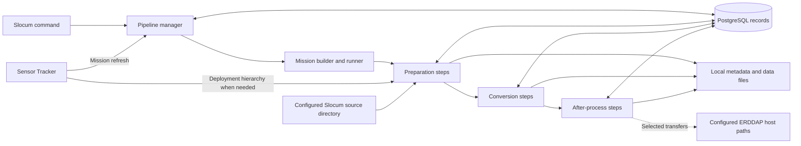
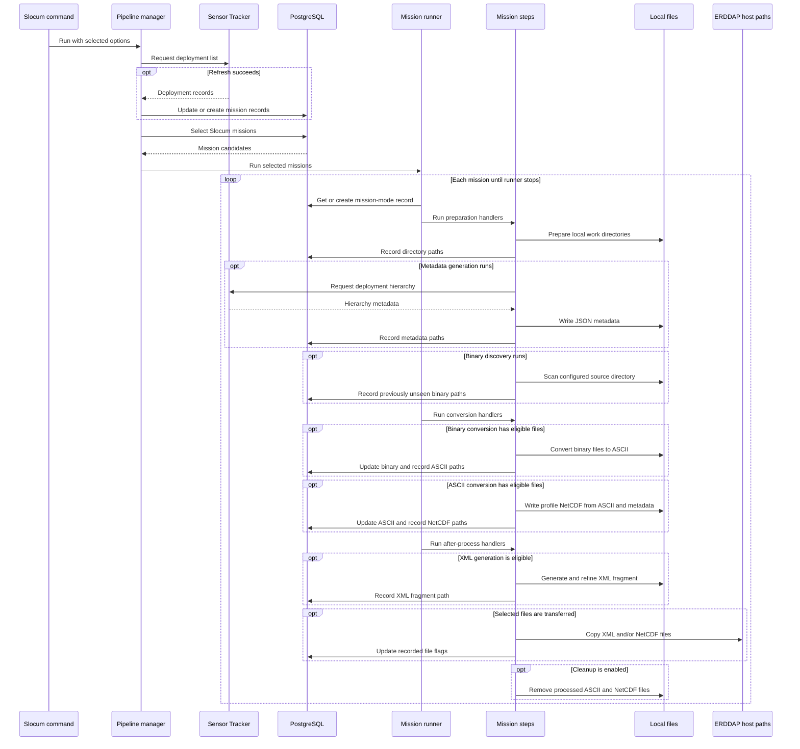

# GDP1 architecture

GDP1's Slocum workflow starts at the Django `slocum_run` command. It uses PostgreSQL to track missions and files, while the data itself lives in configured directories. At the start of a run, the manager attempts to refresh mission records from Sensor Tracker. If that refresh fails, it logs the error and can still select missions already in PostgreSQL. Metadata generation makes a separate Sensor Tracker request when that step runs.

## Component boundaries

The mission builder selects Slocum records and attaches a command plus three ordered process builders to each mission. The runner processes missions one at a time. Each process builder supplies step handlers; command options and existing records determine whether a handler performs work. For steps that save state, the step manager runs the step before calling its Django model manager to record the result.

## Per-mission execution

This sequence shows the order of the major interactions for a mission that reaches its eligible steps. An error can stop the remaining steps for that mission. Each optional block runs only when its command option, required inputs, and recorded state allow it. The [Processing lifecycle page](processing-lifecycle.md) shows the main decisions in more detail.

The file finder compares source paths with paths already recorded for that mission and mode. It does not compare file contents or hashes when deciding whether a path is new. Binary conversion selects existing, unprocessed source files; ASCII conversion can also pick up unprocessed `.dat` files added directly to the mission's ASCII directory. The ASCII step uses JSON metadata to write individual profile NetCDF files.

When requested, the after-process stage can draft an ERDDAP XML fragment from an available NetCDF file and refine it. Separate steps can copy the fragment and NetCDF files to configured host paths. A NetCDF transfer also writes a reload flag; it does not check whether ERDDAP later loads or serves the dataset.

## Stored state and limits

These four Django models form GDP1's processing record in PostgreSQL:

| Model | Role |
| --- | --- |
| `Mission` | Local deployment details refreshed from Sensor Tracker, including number, platform, and start/end times. |
| `MissionProcess` | One record per mission and processing mode; parent of directory and file records. |
| `ProcessDirectory` | The purpose and path of a directory associated with a mission process. |
| `ProcessFiles` | A file type and path associated with a mission process, plus processing and failure flags. |

The `ProcessFiles.processed` flag has a stage-specific meaning. For binary and ASCII inputs, conversion steps update it; for NetCDF and XML files, transfer steps update it. It is not a scientific quality result or a universal mission-complete flag. The `MissionProcess.status` field is present, but the Slocum workflow does not maintain it as an end-to-end run status.

The database stores paths and flags, not copies or fingerprints of the files. A record alone does not prove a file still exists or has the same contents. Existing JSON metadata may be reused, and a changed source file at an already recorded path is not rediscovered simply because its contents changed. Reprocessing can clear selected tracking records, but it is not a complete reset of every related record.

The runner catches errors from one mission and can continue to another; it later logs those errors without reliably returning a nonzero command exit. Individual conversion failures may also be logged or skipped. To assess a run, inspect its logs, recorded paths, actual output files, and the live ERDDAP service where publication matters.

## Where to look in the code

| Source | Responsibility |
| --- | --- |
| `gdp/management/commands/slocum_run.py` and `gdp/core/pipeline/manager.py` | Command options, Sensor Tracker mission refresh, and pipeline startup. |
| `gdp/core/mission/` and `gdp/core/pipeline/runners.py` | Mission selection, per-mission builders, execution, and runner errors. |
| `gdp/core/process/`, `gdp/contrib/step_handlers/`, and `gdp/core/steps/manager.py` | Preparation, conversion, after-process order, and step dispatch. |
| `gdp/contrib/step_implementation/file_finder/`, `gdp/contrib/step_implementation/slocum_processor_handler/`, and `gdp/engine/slocum/` | Source discovery and Slocum conversion. |
| `gdp/contrib/step_implementation/meta/`, `gdp/contrib/step_implementation/errdap_dataset_config/`, and `gdp/contrib/step_implementation/errdap_data_file_upload/` | JSON metadata, XML creation, and optional transfers. |
| `gdp/models.py` | Mission, directory, and file-tracking models. |
