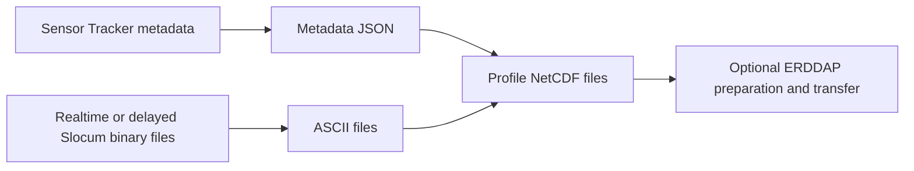

# Glider Data Pipeline V1

GDP1's Slocum workflow can process realtime or delayed slocum glider files into profile NetCDF files.

## Inputs and outputs

At the start of a run, GDP1 attempts to refresh its local mission records from Sensor Tracker. The selected Slocum mode determines which missions and binary files it considers. For eligible files, the pipeline can convert binary data to ASCII, then use that ASCII and JSON metadata prepared from Sensor Tracker to create NetCDF files.

The NetCDF output consists of individual profiles. A run may skip files already recorded as processed, so updating Sensor Tracker metadata alone does not regenerate existing output.

## Publication and review

GDP1 can generate an ERDDAP dataset XML fragment and transfer configuration and NetCDF files when those steps are selected. Generating or transferring files does not confirm that ERDDAP is serving them. GDP1 also does not establish whether the measurements are suitable for a particular scientific analysis; users should review the files and check the live service before relying on either.
