# Processing lifecycle

GDP1 runs each selected Slocum mission through preparation, conversion, and later file-handling steps. The diagram shows their normal order. Command options, recorded files, and available inputs determine which steps run; an error can stop the later steps for a mission.

```mermaid
flowchart TD
    mission["Selected Slocum mission"] --> reprocess{"Reprocessing requested?"}
    reprocess -- Yes --> reset["Clear selected file records or metadata directory"]
    reprocess -- No --> prepare["Prepare directories"]
    reset --> prepare
    prepare --> metadata{"Metadata JSON creation enabled?"}
    metadata -- Yes --> make_metadata["Generate JSON from Sensor Tracker"]
    metadata -- No --> discover{"Binary discovery enabled?"}
    make_metadata --> discover
    discover -- Yes --> find["Find new binary files for enabled mode or modes"]
    discover -- No --> binary{"Binary conversion enabled and unprocessed files found?"}
    find --> binary
    binary -- Yes --> ascii["Convert binary files to ASCII"]
    binary -- No --> ascii_check{"ASCII conversion enabled and unprocessed files found?"}
    ascii --> ascii_check
    ascii_check -- Yes --> netcdf["Write profile NetCDF files"]
    ascii_check -- No --> xml_check{"XML generation requested?"}
    netcdf --> xml_check
    xml_check -- Yes --> xml["Generate XML fragment if unrecorded and NetCDF is available"]
    xml_check -- No --> transfer_check{"File transfer selected?"}
    xml --> transfer_check
    transfer_check -- Yes --> transfer["Attempt enabled XML and NetCDF transfers"]
    transfer_check -- No --> cleanup{"Keep processed local files?"}
    transfer --> cleanup
    cleanup -- No --> remove["Remove processed ASCII and NetCDF files"]
    cleanup -- Yes --> done["End mission"]
    remove --> done
```

## Mission and file selection

GDP1 first attempts to refresh local mission records from Sensor Tracker. Its two automatic Slocum modes select candidates and raw-file types differently:

| Mode | Mission candidates | Binary file types |
| --- | --- | --- |
| Realtime (`--process_realtime_mission`) | Slocum missions with no recorded end time. | `.sbd`, `.tbd`, `.mbd`, `.nbd` |
| Delayed (`--process_delayed_mission`) | All recorded Slocum missions, ordered by descending deployment number. | `.dbd`, `.ebd` |

The automatic delayed runner stops before another mission after it finds unprocessed binary files for one candidate. It does not select only ended missions or guarantee that one mission completed successfully. Explicit mission selection and individual processing options are also available. The two automatic modes enable binary and ASCII conversion, metadata, XML generation, and file transfer options; with explicit options, those stages can be selected separately.

## Reuse and later steps

Existing JSON metadata can be reused, so a Sensor Tracker change alone does not rebuild it. The metadata creation step is conditional. Depending on the selected steps, reprocessing deletes file-tracking records or the metadata output directory before processing resumes. Binary conversion can be skipped when no unprocessed binary files are available; GDP1 can still process unprocessed ASCII files already present.

After conversion, GDP1 can generate an ERDDAP XML fragment if requested, if no fragment is already recorded, and if a NetCDF file is available. XML transfer uses a recorded configuration path; NetCDF transfer selects existing files not yet marked as transferred. Both steps depend on the selected options. By default, cleanup removes local ASCII and NetCDF files marked processed; `--keep_middle_process_files` disables that cleanup.

A transferred file is not proof that ERDDAP serves the dataset. Some failures are logged without a nonzero command exit, so check the outputs and logs when reviewing a run. The [Data products page](data-products.md) explains what the files represent.
