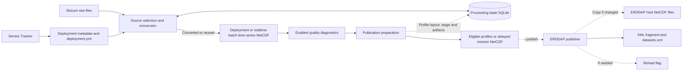
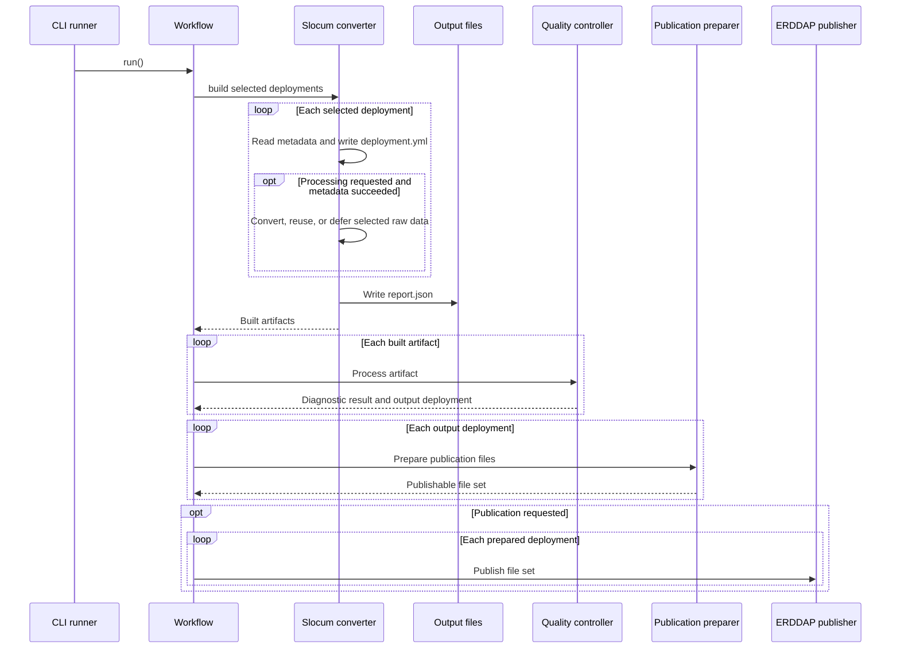
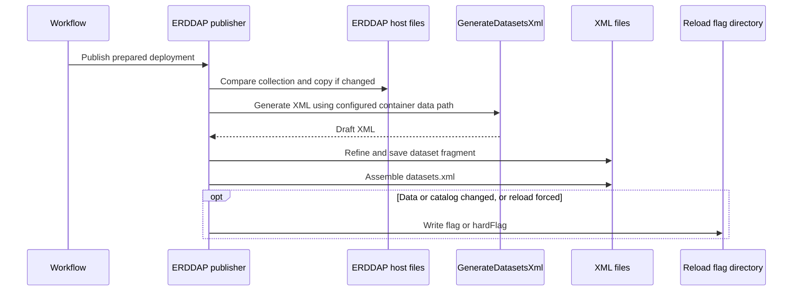

# GDP2 architecture

The current command-line workflow builds products for Slocum deployments. The converter attempts metadata for each selected deployment and, in a processing run, decides whether to convert, reuse, or defer its data. It finishes that pass before the workflow runs enabled diagnostics, prepares files for the chosen publication layout, and, only with `--publish`, prepares an ERDDAP update. Wave conversion is not implemented in this workflow.

## Component boundaries

The SQLite database guides conversion and tracks generated artifacts. The publisher writes to configured ERDDAP host directories; a reload flag requests a refresh but does not show that the live service has loaded the dataset.

## Workflow order

This sequence shows the normal order for a run with selected deployments. The converter can return no artifact for a deployment with a caught error or deferred conversion. A metadata-only run writes YAML for valid metadata but returns no conversion artifacts.

The converter finishes its entire deployment loop and writes `report.json` **before** quality checks or publication preparation begin. The quality controller's default report mode logs depth and position diagnostics and passes the deployment onward; it does not approve the measurements for scientific use. Profile preparation can run with `--process` alone. ERDDAP publication requires `--publish`, which also requires `--process`.

## Conversion and profile preparation

Sensor Tracker supplies the deployment hierarchy used to build `deployment.yml` and determine realtime or delayed mode. Realtime selection uses complete SBD/TBD pairs dated on or after the deployment start; delayed selection uses DBD/EBD files. The processing service compares the selected files and YAML with its saved state. After source selection succeeds, an active run takes priority over the other state decisions, and missing or unstable source files prevent a new conversion:

| Situation | Conversion result |
| --- | --- |
| Raw-file directory is missing | Report a processing error during source selection. |
| A run for that deployment and mode is already active | Report a processing error; recovery is a separate, explicit command. |
| No selected files in an existing input directory, or files still changing | Defer conversion without a new NetCDF artifact. |
| Stable, available files on a first run, with changed inputs, after a failed conversion, or with forced reprocessing | Start a conversion run. |
| Stable, available and unchanged files after a successful run | Verify the saved YAML and NetCDF fingerprints; reuse the NetCDF if verification succeeds. |

Conversion stages eligible files for `pyglider`, then filters its time-series NetCDF to the deployment window. Delayed conversion uses the full selected input. Realtime conversion uses the full input for the initial catch-up, changed existing files or YAML, forced work, and failed-run retries. When new complete pairs can be safely appended to a saved baseline, GDP2 can instead convert a separate realtime batch using the new pairs and the latest previous pair as context when available. If the batch plan is unsafe, it falls back to the full selected input.

Under the default profile layout, GDP2 reuses a verified profile collection when it can; otherwise `pyglider` extracts profiles from the converted or reused time-series file. Newly extracted realtime-batch profiles are merged into the deployment's existing profile collection. For publication, the realtime profile policy excludes the last profile in sorted order; the delayed policy includes all profiles. A configured delayed mission layout uses the deployment time-series file instead of profiles.

## ERDDAP publication

This sequence starts after publication preparation has selected its files. It shows GDP2's actions, not ERDDAP's later loading of a dataset.

The publisher creates a dataset definition, copies a changed NetCDF collection into the configured host location, generates and refines an XML fragment, and assembles `datasets.xml` from saved fragments. It writes a normal reload flag for a data-only change and a hard reload flag for a catalog change or forced reload. If nothing changed and reload was not forced, it writes no flag. GDP2 does not verify that ERDDAP has finished loading or is serving the dataset.

## Stored state and failure boundaries

Processing runs use a dedicated SQLite database with four tables:

| Table | What it records |
| --- | --- |
| `processing_state_source_files` | The source-file baseline for a deployment and mode: path, size, modification time, fingerprint, and observation time. |
| `processing_state_runs` | Conversion attempts, status, timing, source fingerprint, and error text. |
| `processing_state_stages` | Profile-generation stage status for a run. |
| `processing_state_artifacts` | Recorded YAML, deployment or realtime-batch NetCDF, and profile NetCDF paths and fingerprints. |

A successful processing run means conversion and its initial artifact records completed. Quality checks, profile generation, and ERDDAP publication happen later; profile generation has its own stage record. NetCDF and profile files are written outside the SQLite transactions, so the database alone cannot prove that every file still exists or matches. Reuse checks the recorded YAML and time-series NetCDF; profile preparation can verify recorded profiles before reusing them.

For `--process`, the CLI also takes OS file locks for the applicable processing modes before starting the workflow. These locks are separate from the SQLite records. Recovery of a recorded interrupted run requires an explicit command.

`report.json` is separate from SQLite. It contains metadata and processing errors caught during the converter's deployment loop. Those errors allow the loop to continue, but the CLI reports batch failure after the workflow returns. An exception in later diagnostics, preparation, or publication can stop the workflow and is not added to that report.

The optional `--db_create` and `--db_summary` path uses a separate deployment-summary store for platforms, deployments, tracks, and track points. It is not the processing-state database used to decide whether conversion should run.

## Where to look in the code

| Source | Responsibility |
| --- | --- |
| `runner.py` and `GDP/workflow.py` | CLI selection, workflow wiring, stage order, and optional publication. |
| `GDP/slocum/metadata.py`, `GDP/slocum/converter.py`, and `GDP/slocum/deployment_runner.py` | Sensor Tracker metadata, YAML output, and per-deployment error handling. |
| `GDP/slocum/netcdf_generation/` | Raw-file selection, conversion scope, `pyglider` conversion, and deployment-window filtering. |
| `GDP/processing_state/` | Conversion decisions, source snapshots, run and stage records, and SQLite storage. |
| `GDP/quality_control/` and `GDP/slocum/profile_generation/` | Reporting diagnostics, profile extraction, and profile artifact tracking. |
| `GDP/slocum/publication_preparation.py` and `GDP/erddap/` | Publication layouts, NetCDF copying, XML generation, and reload signals. |
| `GDP/deployment_summary/` | Optional, separate deployment-summary storage. |
