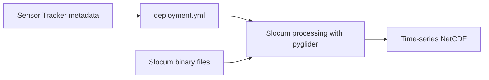

# Glider Data Pipeline V2

GDP2 prepares NetCDF data products for Slocum glider deployments. It reads deployment metadata from Sensor Tracker and creates `deployment.yml` for `pyglider`. A metadata-only run creates that file without converting raw data. A processing run can also convert selected Slocum binary files to a time-series NetCDF file. The current command-line workflow handles Slocum deployments; Wave conversion is not implemented.

## Inputs and outputs

Sensor Tracker metadata determines whether a deployment is realtime or delayed. GDP2 selects the corresponding raw files:

| Mode | Raw files selected |
| --- | --- |
| Realtime | Complete SBD/TBD pairs dated on or after the deployment start. |
| Delayed | DBD/EBD files from the delayed mission input. |

The time-series output is restricted to the deployment's time window. Under the default profile layout, processing also prepares individual profile NetCDF files, even when ERDDAP publication is not requested. A completed metadata or processing run writes `report.json` with the metadata and data-processing errors it caught.

## Reprocessing and publication

GDP2 tracks processing runs and their inputs. It can reuse a previous NetCDF file when inputs are unchanged, retry a failed run, or defer work when no eligible source files are found or files are unstable. An already-active run is reported as a processing error. If report-mode quality checks are enabled, they log depth and position diagnostics; they are not a pass/fail check for the dataset.

ERDDAP publication is a separate, explicitly requested step that requires processing and publication settings. GDP2 copies eligible NetCDF files, updates the dataset configuration, and requests an ERDDAP reload when needed. The reload request does not confirm that the live service is already serving the dataset.
