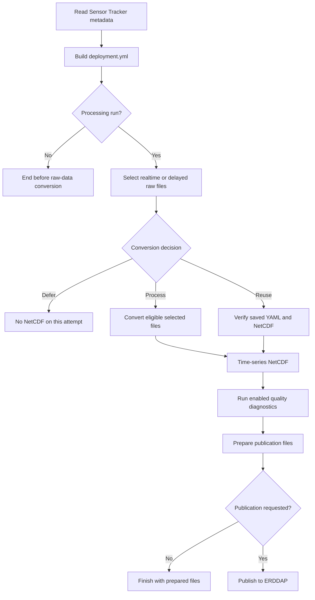

# Processing lifecycle

GDP2 handles each selected Slocum deployment separately. It retrieves Sensor Tracker metadata and writes `deployment.yml`. A metadata-only run ends there. For a processing run, GDP2 selects the deployment's realtime or delayed raw files, then decides whether time-series conversion should run.

## Conversion decision

| Decision | When | What happens |
| --- | --- | --- |
| Process | First attempt, changed source files or `deployment.yml`, retry after a failed conversion, or requested reprocessing. | GDP2 converts eligible raw files into a new time-series NetCDF file. |
| Reuse | Source files and `deployment.yml` are unchanged after a successful conversion. | GDP2 verifies the recorded YAML and NetCDF files, then uses the existing NetCDF without converting again. Missing or changed output is an error. |
| Defer | No source files are selected, or selected files appear to be changing. | Conversion waits; this deployment produces no output for later steps on this attempt. |

A missing raw-file directory is a processing error. An incomplete realtime SBD/TBD pair is excluded from selection, but it does not prevent other complete pairs from being processed.

Deferral is not a conversion failure. GDP2 checks the deployment again when it is selected on a later run. If a processing run for the same deployment and mode is already active, GDP2 reports a processing error rather than treating it as an ordinary deferral.

A new conversion uses the full eligible input for delayed deployments and for realtime catch-up, retries, forced reprocessing, or changed existing inputs. Safe new realtime SBD/TBD pairs can instead be converted as a separate batch with the latest previous pair as context when available. GDP2 falls back to the full selected input if it cannot safely append that batch.

## After the decision

A converted or reused time-series file goes through any enabled quality diagnostics and preparation for the configured publication layout. Under the default layout, this includes profile NetCDF files. ERDDAP publication happens only when requested.

GDP2 records conversion success before these later stages. That status does not establish that diagnostics, profile preparation, or ERDDAP publication succeeded.

GDP2 logs metadata and conversion errors it can handle, records them by deployment in `report.json`, and continues with other selected deployments. The batch reports failure if it recorded any such errors. A later quality-check, profile-preparation, or publication error can stop the workflow; it is not included in `report.json`.
