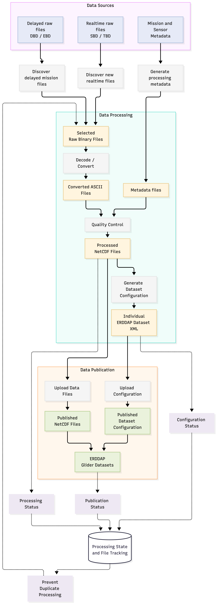

# OTN Glider Documentation

This site describes Ocean Tracking Network's (OTN) glider-related software projects and data pipelines used to record glider deployment metadata, process and publish Slocum Glider data, and retrieve Wave Glider reports.

- **[Sensor Tracker](sensor-tracker/index.md)** is the metadata catalogue for platforms, deployments, instruments, and measured parameters. Its API supplies deployment metadata to the other systems.
- **[Glider Data Pipeline V1 (GDP1)](gdp/gdp.md)** can turn selected realtime or delayed raw (binary) Slocum Glider files into individual profile NetCDF files. It can also generate an ERDDAP XML fragment based on a glider deployment mission and transfer files when those steps are selected.
- **[Glider Data Pipeline V2 (GDP2)](gdpv2/gdpv2.md)** currently handles Slocum processing. It prepares deployment metadata and can produce time-series NetCDF files from selected raw data. A processing run using the default layout can also prepare profiles; ERDDAP publication requires an explicit request.
- **[WGMS Retrieval](wgms-retrieval/index.md)** handles Wave Glider report retrieval. It requests reports from the Wave Glider Management System developed by Liquid Robotics and can write CSV files for reports with records. A completed-mission rebuild keeps any resulting files as candidates until a separate publication step.

## The Glider Data Flow

[{ width="720" style="max-width: 100%; height: auto;" }](imgs/glider-data-flow-mermaid.png)

(Open the diagram to view it at full resolution.)
