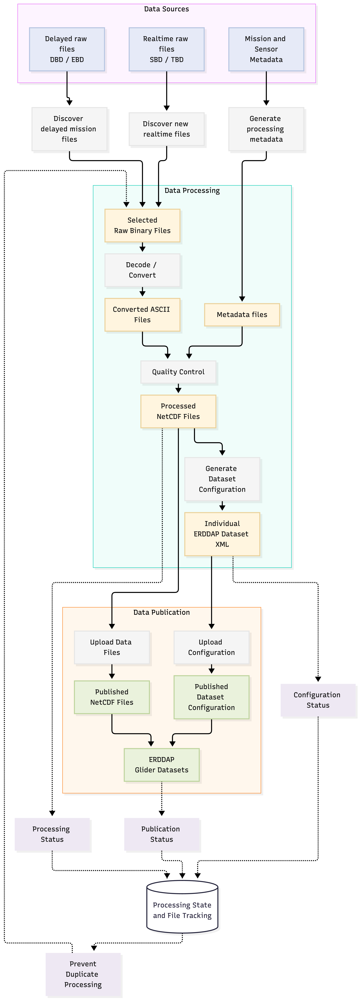

# OTN Glider Documentation

This site documents the systems, components, and workflows that support glider data management at the Ocean Tracking
Network (OTN), from mission metadata and raw data acquisition to processing, storage, and publication.

- **[Sensor Tracker](sensor-tracker/index.md)** manages information about glider platforms, deployments, instruments,
  sensors, and measured parameters, providing metadata to downstream services through its API.
- The **[Glider Data Pipeline (GDP)](gdp/gdp.md)** coordinates mission-based processing of Slocum glider data,
  integrating metadata with raw observations to generate NetCDF data products and the corresponding configurations for
  publication through **ERDDAP**.
- **[Rundeck Glider Jobs](glider-rundeck/index.md)** automate and coordinate operational workflows across the glider
  data infrastructure, including
  data transfers, synchronization, pipeline-related tasks, and routine system maintenance.

The documentation also covers supporting infrastructure and services, including data fetchers, automated workflows
orchestrated through Rundeck, processing databases, file storage, and ERDDAP deployment. Together, these components
support the ingestion, processing, management, and dissemination of glider observations.

## The Glider Data Flow

[{ width="720" style="max-width: 100%; height: auto;" }](imgs/glider-data-flow-mermaid.png)

(Open the diagram to view it at full resolution.)
