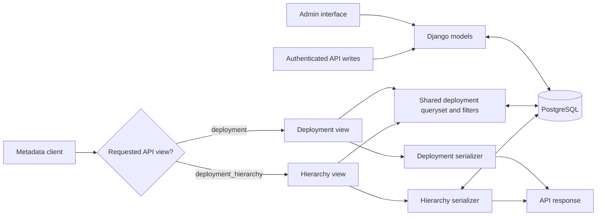
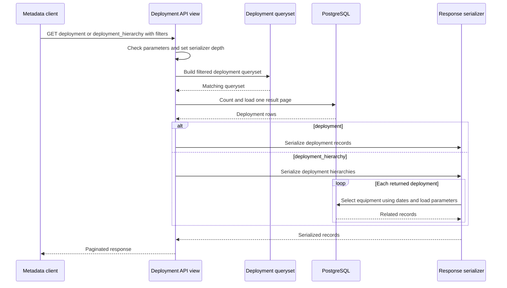

# Sensor Tracker architecture

Sensor Tracker is a Django application backed by PostgreSQL. Staff maintain records through the admin interface, and authenticated API clients can create or update records. Read clients can request deployment records or a hierarchy assembled from related equipment. The hierarchy is built for the response; it is not stored as a separate snapshot.

## Component boundaries

Both deployment views use the same deployment queryset. Their serializers define the difference: `deployment` returns deployment metadata, while `deployment_hierarchy` adds selected equipment and parameters. Calibration records and events have separate API views and are not part of the deployment hierarchy.

## Deployment read path

This sequence shows a list request. The API accepts deployment filters, selects one result page, and serializes that page. The hierarchy branch makes additional reads for each returned deployment.

Filters include platform name, platform model, deployment number, and deployment start or end time. The API checks query keys and uses limit/offset pagination for list requests, with a default page size of 100. A deployment number is optional and not unique, so a client must handle multiple matches. The `depth` option expands ordinary serializer relationships; it does not control whether the hierarchy's explicit equipment fields are added.

Read requests are permitted without authentication. The API's create and update operations require token or session authentication. Saving a record does not invoke a glider pipeline or WGMS Retrieval; those clients read Sensor Tracker during their own workflows.

## Stored relationships and hierarchy limits

A deployment points to a platform, responsible institution, and project. Equipment and parameter records are stored separately. Dated links attach instruments, data loggers, and components to platforms; other links attach instruments to loggers or instruments, and sensors to instruments or loggers. Each link has a required start time and an optional end time.

The hierarchy serializer selects platform components, instruments, and data loggers, then nests instruments under data loggers and sensors under instruments. It nests parameter records under the equipment they reference. The top-level instrument query can include instruments linked through a data logger, so an instrument may appear both at the top level and under a logger. Nested sensors come from dated instrument–sensor links, not the sensor's `current_instrument` field. Direct logger–sensor and instrument–instrument links are stored but not traversed by this hierarchy serializer. Calibration events are also outside this response.

Date selection is not one universal overlap rule. The shared attachment selector uses the deployment start and, where passed, end time to find links spanning that interval. The top-level data logger query uses the deployment start alone. When a deployment has no start time, the shared selector applies no date filter, so a hierarchy can include historical attachments. A response therefore reflects the stored relationships and the selection logic at read time, not a validated inventory of the deployment.

## Where to look in the code

| Source | Responsibility |
| --- | --- |
| `sensor_tracker/urls.py` and `api/urls.py` | Mount the API and register its views. |
| `api/views.py` and `api/core/api_base.py` | Choose querysets and serializers; handle accepted parameters, depth, permissions, and list or detail reads. |
| `api/core/queryset_methods/platforms/deployment.py` and `api/core/queryset_methods/queryset_base.py` | Define and combine deployment filters. |
| `api/core/hierarchy_serializer.py`, `platforms/model_managers.py`, and `common/model_managers.py` | Assemble the hierarchy and select dated equipment relationships. |
| `platforms/models.py`, `instruments/models.py`, and `calibration/models.py` | Define the stored deployment, equipment, attachment, parameter, and calibration records. |
