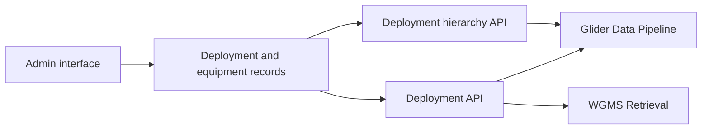

# Sensor Tracker

Sensor Tracker is a catalogue of the platforms, deployments, and instruments used in glider missions. Staff maintain its records through an admin interface. Other systems request the metadata through a REST API.

## Records and relationships

| Record | What it describes |
| --- | --- |
| Platforms and deployments | A platform's name, serial number, type, and owning institution. A deployment links the platform to a responsible institution and project, with a title and optional number, start time, and end time. |
| Equipment and parameters | Instruments, data loggers, sensors, and components. Parameter records provide variable identifiers and can include names and units. |
| Attachment history | Dated links show when equipment was attached to a platform or to other equipment. An attachment can have an end time when it is removed. |
| Calibration history | Calibration records can be linked to equipment and have dated calibration events. |

The attachment history matters when equipment changes between deployments: it gives Sensor Tracker dates to use when assembling metadata for a deployment.

## How the metadata is used

The deployment API returns deployment records. The hierarchy API assembles a deployment with selected related equipment and parameters. Calibration events are separate records and are not part of that hierarchy response.

| Consumer | Use of Sensor Tracker metadata |
| --- | --- |
| [Glider Data Pipeline V1](../gdp/gdp.md) | Updates its mission records from deployments and reads the hierarchy when generating metadata. |
| [Glider Data Pipeline V2](../gdpv2/gdpv2.md) | Selects deployments and maps the hierarchy into `deployment.yml` for processing. |
| [WGMS Retrieval](../wgms-retrieval/index.md) | Uses Wave Glider deployment details and times to plan report retrieval. |

Sensor Tracker supplies metadata to these systems; it does not convert raw glider files or publish processed data products.
