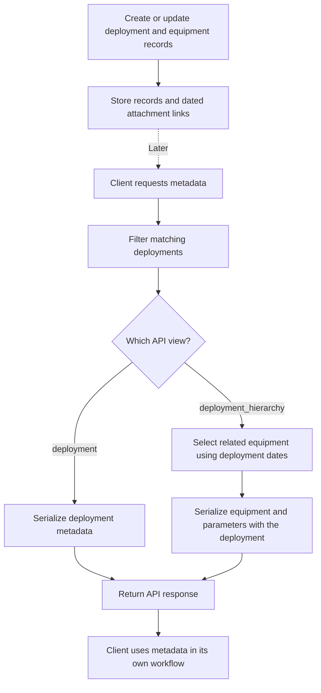

# Metadata lifecycle

Sensor Tracker stores deployments, equipment, and their relationships as separate records. On a later API read, it filters deployments and builds either a deployment response or a hierarchy with selected related equipment. Downstream systems request this metadata during their own runs.

## Maintaining records

Staff can create and edit records in the admin interface; authenticated API clients can also create or update records. A deployment links a platform, responsible institution, and project. Equipment attachments are separate records with a start time and an optional end time. Parameter records may be linked to sensors, instruments, or data loggers. The [metadata records page](metadata-records.md) explains these relationships.

Saving a deployment or equipment change does not create a stored hierarchy or start a pipeline run. The hierarchy is assembled when its API view is requested.

## Serving metadata

Both `deployment` and `deployment_hierarchy` use the deployment filters. The first returns deployment metadata. The second adds selected components, instruments, and data loggers; it nests instruments under data loggers, sensors under instruments, and parameters under equipment records. Selection of related equipment uses recorded dates, so changing a deployment or attachment date can change a later hierarchy response. Calibration events are available separately and are not included in this hierarchy.

A deployment number is optional and is not guaranteed to identify one record. Clients that filter by number need to check the returned matches.

## Downstream use

[GDP1](../gdp/gdp.md) and [GDP2](../gdpv2/gdpv2.md) read Sensor Tracker metadata for their own processing; [WGMS Retrieval](../wgms-retrieval/index.md) reads deployment details to plan report retrieval. A Sensor Tracker save does not regenerate their existing output files; those depend on separate consumer workflows.
