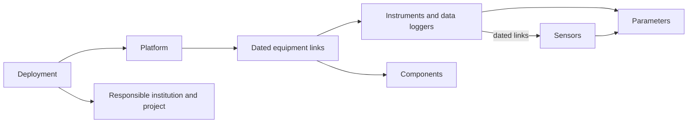

# Sensor Tracker metadata records

Sensor Tracker keeps platforms, their deployments, and equipment in separate records. A platform can have more than one deployment, while dated attachment records can describe changes in its equipment over time.

## How the records connect

These are selected relationships among the stored records. Equipment links have their own start and optional end times.

## What each record tells you

| Record | Information to look for |
| --- | --- |
| Platform | Name, serial number, platform type, and owning institution. |
| Deployment | The platform, responsible institution, project, and title. A deployment number and start and end times may also be recorded. |
| Equipment attachment | The instrument, data logger, sensor, or component involved, what it was attached to, and when the attachment began and, if recorded, ended. |
| Parameter | An identifier used for a variable in raw data, with optional descriptive names, standard name, and units. Each parameter also has an `include_in_output` setting and can be associated with a sensor, instrument, or data logger. |
| Calibration | A calibration record can refer to equipment. Its events have dates and may include a type, who performed the work, and comments. |

## Reading dates and missing fields

Deployment start and end times are optional and should be entered in UTC. Sensor Tracker has no separate mission-status field. GDP2 interprets a missing deployment end time as realtime and a recorded end time as delayed; that is a pipeline decision based on the metadata. Attachment records require a start time, while their end time may be empty.

The `include_in_output` setting records whether parameter data should be included in processed output. It does not prove that a variable appears in a particular data file. The deployment-hierarchy API uses recorded dates to assemble selected equipment for a deployment. It does not nest sensors directly under data loggers, and calibration events are separate records.
