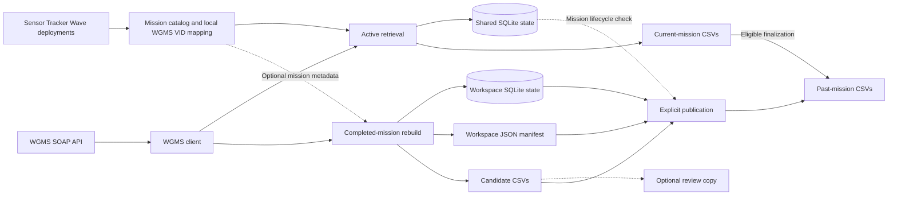
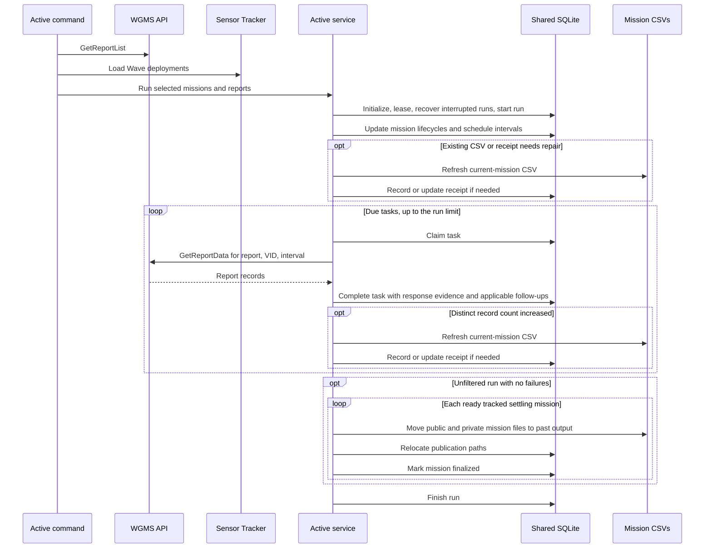
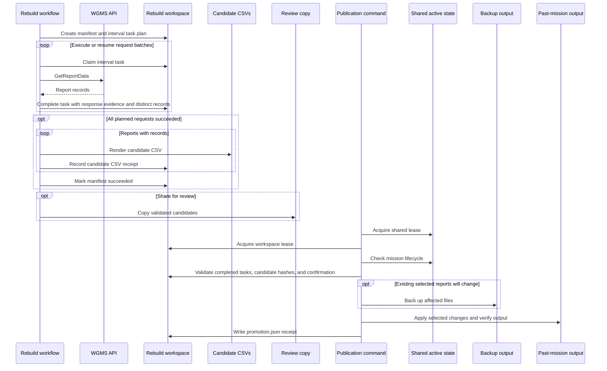

# WGMS Retrieval architecture

WGMS Retrieval has two execution paths: active-mission retrieval and completed-mission rebuild. They use the same WGMS client and record handling, but keep their work in separate state stores. The command-line entry points assemble mission details, report names, and the chosen workflow.

## Component boundaries

The mission catalog turns Sensor Tracker deployment metadata into missions the extractor can use. A local mapping supplies the WGMS vehicle identifier (VID); it is not supplied by Sensor Tracker. Active retrieval uses this catalog. A rebuild can instead take explicitly supplied details for one completed mission. The WGMS client obtains report names and calls `GetReportData` for each requested interval. A new active or rebuild plan fetches WGMS report names; active planning also fetches Sensor Tracker deployments. A resumed rebuild can use its saved plan. Report-data requests happen only when execution is requested.

Current- and past-mission output each have public and private areas. The report publisher routes some report names to the private area. A review copy is a separate destination and should not be treated as public output.

## Active retrieval

This sequence shows the successful path of an executed active run. A plan-only invocation stops before the service takes a lease or requests report records.

Initial requests cover adjacent windows of at most 15 minutes. An initial request advances its report's checkpoint only when it completes at the next expected boundary; a delayed recheck of the same window does not advance coverage. For an initial task, response counts, distinct records, the checkpoint advance, and any delayed recheck tasks are stored in one SQLite transaction. An empty response can therefore advance coverage without creating a CSV.

The service holds a renewable lease while it works. A later run can requeue tasks left running by an interrupted run. It refreshes a report CSV when the number of distinct records increases, and repairs missing or incomplete publications on a later run. CSV replacement and its SQLite publication receipt are separate operations.

Finalization requires an ended tracked mission, checkpoints through its end for every report, and no unfinished tasks. It runs only after an unfiltered execution with no failures, then moves the mission's public and private files to past-mission output. The move can recover an identical partial move; it is not one database transaction with the file changes.

## Completed-mission rebuild and publication

An executed rebuild creates its own workspace with a SQLite database, a progress manifest, and candidate output. It can resume work across executions without changing the active database or past-mission files. The sequence follows a completed rebuild and a later executed publication; it omits failed attempts.

Publication is a separate command that requires explicit execution and an exact mission confirmation. It refuses a mission still marked active or settling in shared state. It checks the completed task plan and candidate file hashes, then creates, replaces, leaves unchanged, or removes only the reports selected by the rebuild. A selected report with no records can remove an existing past-mission CSV. Affected existing files are backed up in a separate location, the result is verified, and `promotion.json` is saved in the workspace. If application fails, the code attempts to restore previous files. The software permits publication without a review copy and does not independently establish that a person approved the candidate.

## Stored state

The shared active database and each rebuild workspace database use the same nine-table SQLite schema. The rebuild workspace also holds a JSON progress manifest; successful publication adds a separate `promotion.json` file. These are the table groups that matter when tracing a run or investigating a report:

| Concern | Tables | Purpose |
| --- | --- | --- |
| Execution | `retrieval_runs`, `execution_leases` | Record retrieval runs and hold renewable, per-database execution leases. |
| Scheduling | `mission_lifecycles`, `interval_tasks`, `checkpoints` | Track mission status and contiguous initial-request coverage for active retrieval; interval tasks serve both paths. |
| Response evidence | `task_record_batches`, `task_record_observations`, `canonical_records` | Store response counts, including empty responses; observed record occurrences; and distinct full records per mission, VID, and report. |
| CSV output | `report_publications` | Record a generated CSV's destination, row count, checksum, and publication time. |

SQLite enforces four relationships: an `interval_tasks` claim can reference `retrieval_runs`; `task_record_batches` references its interval task; and each `task_record_observations` row references a batch and a `canonical_records` row. The claim link is nullable and records a task's current or last claim, not every attempt.

Lifecycle rows share mission number and VID with report-level rows; `interval_tasks`, `checkpoints`, `canonical_records`, and `report_publications` also carry report name. The application associates those rows by these values, but SQLite does not enforce those shared-value associations. A checkpoint means initial windows completed contiguously, even if WGMS returned no records; it does not establish scientific validity.

A `report_publications` row records a CSV at publication time, but does not prove the file still matches. Active-output repair checks file existence, receipt presence, and record count before deciding whether to republish; it does not rehash a file that passes those checks. Rebuild publication validates candidate hashes against receipts in its workspace database and writes `promotion.json`; it does not update the shared database's `report_publications`.

## Where to look in the code

| Package | Responsibility |
| --- | --- |
| `commands/` | CLI entry points, planning, execution, review sharing, and publication. |
| `missions/` | Sensor Tracker deployment conversion and local WGMS VID mapping. |
| `wgms/` | Authenticated WGMS API client and response handling. |
| `workflows/active/` | Interval scheduling, active requests, CSV repair, and mission finalization. |
| `workflows/rebuild/` | Isolated workspaces, resumable requests, candidate validation, and promotion. |
| `persistence/` and `reports/` | SQLite state, record identity, CSV writing, and comparisons. |
