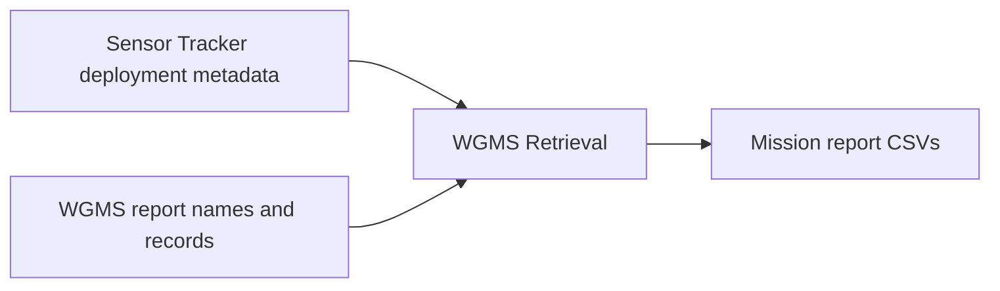

# WGMS Retrieval

WGMS Retrieval collects reports for Wave Glider missions and writes CSV files for reports with retrieved records. It uses Sensor Tracker deployment metadata to identify active missions and their time ranges, and requests report names and records from WGMS.

## Inputs and outputs

Each CSV contains records for one mission and one WGMS report. Report names and record fields come from WGMS, so the available files and their columns can differ between reports.

## Retrieval paths

| Path | What happens |
| --- | --- |
| Active missions | The extractor requests report data in time windows and rechecks those windows later for additional records. After a tracked mission ends and its retrieval work is complete, an unfiltered run can move its CSV files to past-mission output. |
| Completed-mission rebuild | The extractor retrieves one completed mission into a separate workspace. Once all planned requests succeed, it creates candidate CSV files. Those files can be shared for review; publishing them to past-mission output requires a separate, explicit step. |

A completed-mission rebuild can use Sensor Tracker metadata or explicitly supplied mission details. Creating a CSV does not assess whether its measurements are suitable for scientific use.
