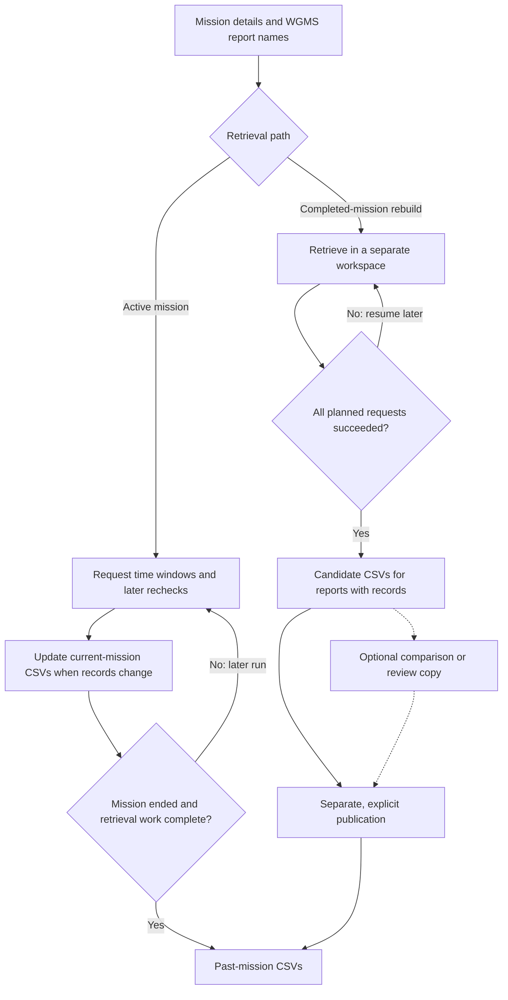

# Retrieval and review lifecycle

WGMS Retrieval has two paths. The active-mission command follows missions that are ongoing when first observed. A completed-mission rebuild retrieves one ended mission into a separate workspace. Both commands show a plan by default; requesting report records requires explicit execution.

## Active missions

For each tracked mission and report, the extractor requests records in bounded time windows. It holds back the newest interval while a mission is active, then schedules later rechecks of each completed window to look for additional records. New distinct records cause that report's current-mission CSV to be refreshed. Failed requests can be retried on a later attempt.

When Sensor Tracker supplies an end time for a mission already being tracked, the extractor continues through the remaining windows and rechecks. In an unfiltered run with no failures, it moves the mission's CSV files to past-mission output only after every report stream reaches the mission end and no tasks remain unfinished. A run with a report-name filter does not finalize a mission, even if that filter lists every available report. A mission first encountered after it has ended is not enrolled in this active workflow.

## Completed-mission rebuilds

A rebuild plans requests across one completed mission, then saves its progress in an isolated workspace. It can resume there if the work takes more than one execution. Candidate CSVs are created only after every planned request succeeds; this does not change the existing past-mission files.

The candidate can optionally be compared with existing output or copied to a technician review area. Neither action publishes it. A separate publication step validates the completed candidate, requires explicit execution and mission confirmation, and changes only the reports selected by the rebuild. It backs up affected existing files and verifies the result. The software does not independently verify that a person reviewed or approved the candidate.
